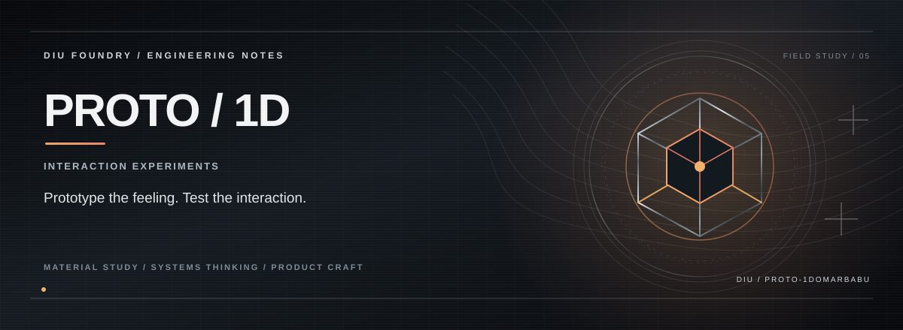

> **INTERACTION EXPERIMENT.**

## THE PREMISE

Proto / 1D is a deliberately loose interface laboratory for testing product interactions, visual hierarchy and responsive behaviour without pretending the experiment is already a finished platform.

## THE EXPERIENCE

**Prototype the feeling.**  
**Stress the interaction.**  
**Keep the code easy to reshape.**

## THE SYSTEM

A component-driven React/TypeScript frontend keeps the experiment lightweight while Vite, Tailwind and reusable UI primitives make iteration fast.

## THE STACK

React 18 · TypeScript · Vite · Tailwind CSS · React Router · Recharts

## RUN

Requirements: Node.js and npm.

```bash
npm ci
npm run dev
```

Vite prints the local development URL. Quality checks:

```bash
npm run build
npm run lint
npm test
```

The repository is an interaction prototype; review the code for the current implementation details.

## PROJECT STATE

**Experimental prototype**

The repository documents the capabilities that are actually implemented; future integrations are intentionally separated from the current product surface.

---

<p align="center"><strong>K. KISHOR KUMAR</strong><br><sub>ENGINEERING / PRODUCT / SYSTEMS</sub></p>
